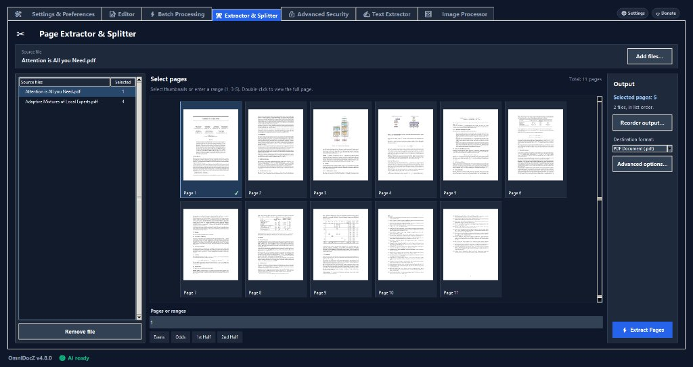
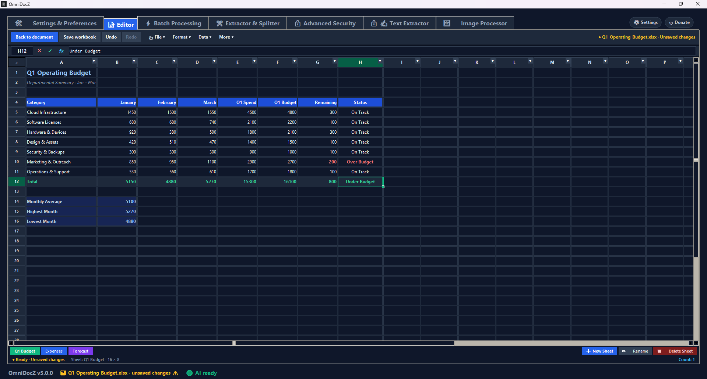
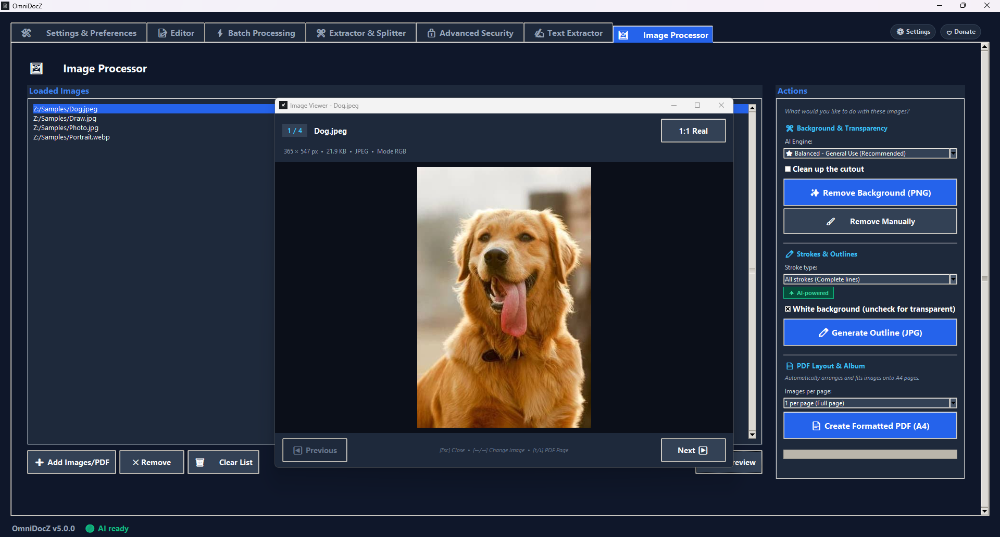
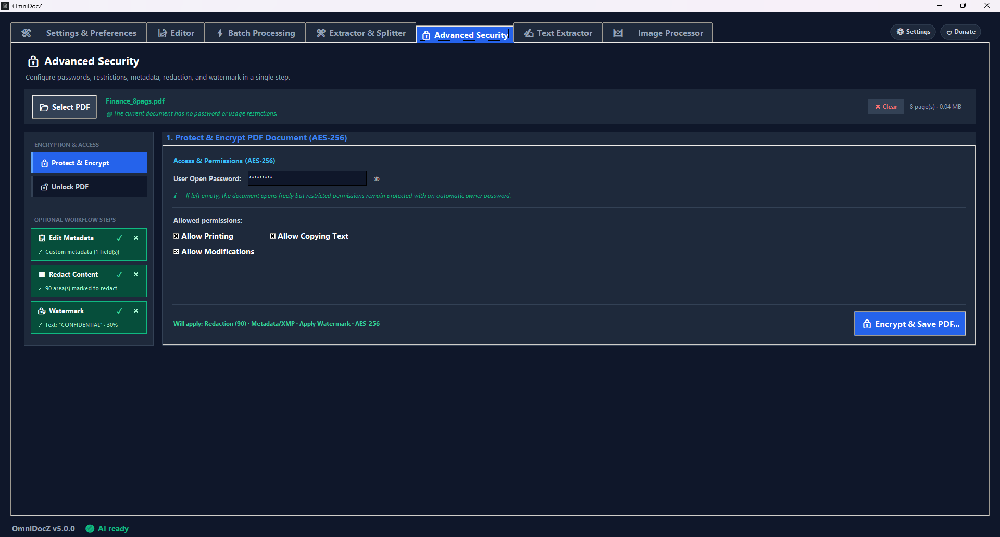
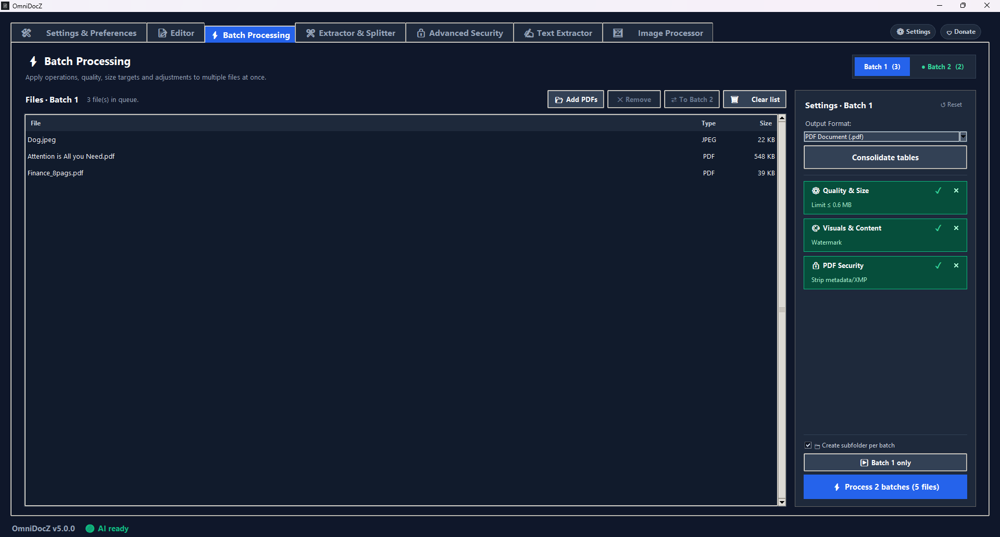

[README.md](https://github.com/user-attachments/files/35533181/README.md)

# OmniDocZ

**Edit PDFs, work with spreadsheets, clean up scans, and convert files on your PC.**

Combine Word documents, PDFs, spreadsheets, and images in one workspace. Edit native or scanned text in place, sign and fill PDFs directly in the editor, work seamlessly with spreadsheets, organize and extract pages visually, protect files in one pass, and process dual batches offline.

  

**Windows 10 / 11 (64-bit) · Free and ad-free · Local processing · 6 languages**

[Download](#download-and-install) · [Documents & PDFs](#documents-and-pdfs) · [Spreadsheets](#spreadsheets-excel-mode) · [OCR & Scans](#ocr-and-scan-cleanup) · [Images](#image-tools) · [Security & Forms](#pdf-security-and-forms) · [Batch & Settings](#batch-processing-and-preferences)

  

## Download and install

1. Open the [latest release](https://github.com/Nightmare13123/OmniDocZ/releases/latest).
2. Under **Assets**, download **`OmniDocZ-Setup-<version>.exe`**.
3. Run the installer and open **OmniDocZ**. Drag files into any tab or click **Browse File** to begin; the interactive guide walks through all 7 tabs on first launch (and can be skipped anytime with `Esc`).

Document processing runs locally on 64-bit Windows 10 or 11 with no account or subscription. An internet connection is used only for downloads, optional SHA-256-verified add-on bundles, and update checks. Available in **English, Spanish, French, Portuguese, German, and Italian** (auto-detected from Windows, defaulting to English if another system language is set).

| Release asset | What it gives you |
| --- | --- |
| `OmniDocZ-Setup-<version>.exe` | The Windows desktop application. Start here for a new installation or update. |
| `ai_bundle.zip` | Optional offline AI for OCR on scanned pages, automatic background removal, and AI line-art outlines & silhouettes. Select it during setup, or install, update, and repair it anytime from the AI status indicator in the bottom bar (or **AI component…** in the version menu). |
| `fonts_bundle_essential.zip` and `fonts_bundle_full.zip` | Optional typeface collections (**20** core families or **63** full families) for document editing. Install during setup or via **Get more** in the editor’s font menu. You can also import your own `.ttf`/`.otf` fonts. |

## Documents and PDFs

### Edit and compose

- **Edit text in place:** Turn on **Edit Text** to modify native or scanned PDF text directly on the page. OmniDocZ matches the original font, size, color, and ink intensity, applies formatting to selected words within a line, runs in-place OCR extraction in the background without freezing the UI, and preserves selectable text, bookmarks, native hyperlinks, and form fields on PDF export.
- **Compose from scratch or build on existing files:** Add formatted text with paragraph alignment, movable text boxes, floating resizable images, clickable hyperlinks, and editable tables (with XLSX/ODS/CSV export). Typing or pasting past the bottom margin automatically creates a continuation page and flows overflow text, formatting, and hyperlinks onto it (reversible with `Ctrl+Z` / `Ctrl+Y`).
- **Sign and fill directly on the page:** Open **Sign PDF** right from the Editor toolbar to draw a signature (3 ink colors, stroke undo, and **Save PNG**), import a scanned signature (with automatic white-background cleanup), or stamp a transparent/paper-matched text seal—movable and resizable on the page, with optional incremental **PAdES** cryptographic sealing (`.pfx`/`.p12`) on PDF save. Use **Fill Form** on the same toolbar to complete interactive PDF forms.
- **Draw, highlight, and adjust pages:** Annotate smoothly with pen, highlighter, and stroke eraser tools (with full undo/redo), zoom fluidly from the bottom bar, rotate pages, and change page dimensions (Letter, A4, Legal, Square, or custom). The toolbar adapts automatically to compact windows down to `900 × 650`.
- **Ready-to-use typography:** Choose from 100+ fonts in the editor (including 25 bundled open-source families and a recent-fonts shortcut), expand with optional packs, or add your own `.ttf`/`.otf` fonts.

### Combine, organize, and extract

- **Merge mixed formats:** Load PDFs, Word or OpenDocument files, spreadsheets, and images into one workspace and export as a single document. Use **Consolidate tables** to review worksheets and document tables before saving them to a workbook.
- **Organize files or pages:** Reorder whole source files when working with multiple documents, or rearrange, rotate, delete, and insert blank pages using thumbnail previews.
- **Visual Extractor & Splitter:** Browse thumbnails across one or more documents, open full-page previews, select pages visually or with quick presets and ranges, reorder the output sequence directly, set a target MB limit, and add page numbers or watermarks before exporting.

### Preview, optimize, and export

- **Fit a target file size:** Set a maximum size in MB and pick **Original**, **Balanced**, **High**, or **Ultra** quality across **Settings & Preferences** (Docs & Excel), **Batch Processing**, **Extractor & Splitter**, and **Advanced Security**—including on documents and spreadsheets created from scratch. Content-aware compression distinguishes text and diagrams from photos, keeps **Original** lossless, and estimates achievable sizes across PDF, DOCX, XLSX, ODS, PNG, JPEG, and WebP.
- **Live Preview & quick return:** **Live Preview** is enabled by default (and remembered across sessions) so you see color inversion, watermarks, and page numbering applied in real time before saving. Reopen your last 3 documents anytime from **Recent files** on **Settings & Preferences**.
- **Consistent branding and pagination:** Add text or logo watermarks with adjustable opacity, and stamp headers, footers, and page numbers with custom placement, format, font, starting number, and cover-page skipping.

| Task | Supported formats and options |
| --- | --- |
| Open or combine documents | PDF, Word `.docx`, Writer `.odt`, Excel `.xlsx` / `.xls`, Calc `.ods`, `.csv`, PNG, JPEG, and WebP |
| Export documents or extracted pages | PDF, archival PDF/A-1b, DOCX, ODT, PNG, and JPEG (`XLSX`, `ODS`, and single-sheet `CSV` unlock automatically—highlighted in green—when working with spreadsheets, detected document tables, editable editor tables, or reviewed table extractions) |
| Extract tabular data | Review detected PDF tables in **Extractor & Splitter** or native Word and ODT tables from **Settings & Preferences → Extract tables** before opening them as sheets or exporting to XLSX/ODS (or a single selected table to CSV). |

*Output options follow the active source content so text-only PDFs, plain documents, and images stay in document/OCR flows rather than creating empty spreadsheets.*

| Settings & Preferences — Export, size limits & recent files | Extractor & Splitter — Visual page selection |
| :---: | :---: |
|  |  |

## Spreadsheets (Excel Mode)

Open or create workbooks, clean up extracted tables, reuse any selected range as an editable table inside a document, save your spreadsheet atomically, or export a paginated PDF ready to combine with other files.

| Area | What you can do |
| --- | --- |
| **Compact editor & quick panel** | Work from a streamlined, keyboard-accessible top bar (**Back to document**, **Save workbook**, **Undo**, plus **File**, **Format**, **Data**, and **More** menus; toggle the full advanced ribbon anytime with `Ctrl+F1`). In the redesigned Excel view of **Settings & Preferences**, monitor workbook status and unsaved changes, switch the **Active sheet**, launch **Open in Editor**, reopen up to 3 **Recent workbooks**, run cleanup toggles, configure output & **PDF options…**, open **PDF Preview**, or **Save copy**. |
| **Fast virtualized grid** | Virtualized rendering across all sheet sizes keeps opening workbooks, switching between Docs and Excel (preserving active sheet, focus, selection, scroll position, edits, and undo history), and jumping between sheet tabs fast and flicker-free. Large files load in the background with a cancellable notice. Add, rename, duplicate, reorder, and color-code tabs; insert, delete, hide, and resize rows/columns; freeze panes, zoom, and fit cleanly down to `900 × 650`. |
| **Formulas & data cleanup** | Use common formulas (`SUM`, `SUMIFS`, `IF`, `COUNTIF`, `VLOOKUP`, `XLOOKUP`, and more), AutoSum, auditing, and automatic or manual recalculation (including recalculating uncached `.xlsx` formulas on open). Clean sheets from the **Data** menu or the **Settings & Preferences** quick-cleanup toggles with live counters (**Text to number**, **Delete empty rows**, **Remove duplicates**, **Auto-fit columns**, and **Format selection**)—apply immediately with Undo or automatically on save. |
| **Recover & reuse tables** | Review detected PDF tables (**Extractor & Splitter**), native `.docx`/`.odt` tables (**Settings & Preferences → Extract tables**), or mixed batches (**Consolidate tables**) with source provenance and preview before opening as sheets or exporting. Insert any selected spreadsheet range into the active document as an editable table (preserving empty cells, with confirmation, 50-row editor cap, and document Undo), or export editable document tables directly to XLSX/ODS/CSV. |
| **PDF Preview & sharing** | Preview exact page breaks before exporting the **Active sheet only** or **Whole workbook** to PDF, with paper size, orientation, margins, print area, fit columns to 1 page wide, hidden rows/columns respected, optional watermarks, color inversion, and file-size/quality controls—then combine the resulting PDF with other documents in OmniDocZ. |

  

### Spreadsheet format differences & saving complex workbooks

| Format | What is saved / supported |
| --- | --- |
| **XLSX** | Multi-sheet workbook preserving supported formulas, cell formatting, column widths, merged cells, and leading-zero text codes (e.g. `00123`), with optional MB target optimization. `Ctrl+S` always saves the full workbook atomically. |
| **ODS** | Multi-sheet OpenDocument spreadsheet preserving values and supported formulas, with optional MB target optimization. |
| **CSV** | Single active sheet (evaluated values, no styles), preserving the detected delimiter (`,`, `;`, tab, `|`) and text codes. Exporting a CSV copy leaves the open multi-sheet workbook untouched. |
| **XLS** | Read-only import of cell values; saving prompts to write a new `.xlsx` copy without overwriting the original `.xls` file. |
| **PDF** | Paginated output matching **PDF Preview** (active sheet or whole workbook, page setup, print area, watermark, inversion, and size target). |

> **Tip for complex third-party workbooks:** Macros (`.xlsm`), pivot tables, and unsupported Excel-specific functions are outside the spreadsheet editor’s native scope (unsupported formula text is preserved, while Excel recalculates cached values when reopened). Use **Save copy** to keep the original third-party workbook intact.

## OCR and scan cleanup

- **Auto-crop and deskew scans:** Trim dark borders, center the page, and straighten tilted scans in one step (**Auto-Crop & Deskew**), adjust the four corners manually for perspective correction, or straighten content on its own.
- **Guided scan preparation & responsive OCR:** Before running in-place OCR editing, OmniDocZ detects tilted or uncropped scans and suggests adjusting them first for cleaner text alignment. In-place OCR extraction runs in a cancellable background worker so the interface stays responsive while scanning.
- **Create searchable PDFs:** Use **Make PDF Searchable** to overlay a selectable, searchable text layer onto scanned PDFs or images without altering their look, with language profiles (European/Spanish or English), selectable resolution (150–450 DPI), and optional image enhancement.
- **Recover text selectively or in full:** Use **Extract Text** in the editor to copy text from any region, or open PDFs, DOCX, ODT, and images in **Text Extractor** to recover, format, and export editable text.

*OCR on scanned pages and images requires the optional local AI component.*

## Image tools

| Tool | What you can do |
| --- | --- |
| **AI background removal** | Remove backgrounds locally in batch and save transparent PNGs. Choose between **Balanced** (ISNet), **Maximum detail** (BEN2 FP16), and **Ultra Fast** (Silueta) modes, with background pre-warming, hardware guidance, automatic model fallback, and optional edge cleanup. |
| **Manual cleanup** | Fine-tune transparency and edges by hand with brush, eraser, selection, and crop tools with undo support. |
| **Outlines & silhouettes** | Generate continuous, closed coloring-page line art with the local AI **Contour FP16** model, or trace outer perimeter silhouettes for stickers, logos, and stencils with AI subject isolation (ISNet / Silueta). Includes an instant offline classic engine when AI isn’t installed—saving as JPEG (white background) or transparent PNG. |
| **A4 layouts & image viewer** | Lay out images or PDF pages into printable albums or contact sheets (1, 2, 3, 4, 6, or 8 per page, or automatic layout preserving proportions), and inspect files in the built-in viewer with fit-to-window, actual size, dimensions, and file size. |

*AI background removal, AI Contour line art, and automatic silhouettes use the optional local AI component; manual cleanup, classic outlines, A4 layouts, and the viewer work without it.*

  

## PDF security and forms

| Tool | What you can do |
| --- | --- |
| **Single-pass protection & unlock** | In the redesigned **Advanced Security** workspace, load any PDF to switch automatically between **Protect & Encrypt** and **Unlock PDF** (including PDFs with owner restrictions only). Configure **AES-256** encryption, open passwords, granular permissions (printing, copying, modifying), watermarks, color inversion, and compression/MB target, then chain optional redaction and metadata cleanup into a single atomic save. |
| **Permanent redaction** | Mark areas visually or find all matches of a phrase (deduplicated), then permanently strip the underlying text and images—standalone or chained inside the single-pass **Advanced Security** workflow. |
| **Metadata & XMP cleanup** | Inspect, edit, or clear PDF properties (title, author, subject, keywords, creator, producer) and purge hidden **XMP XML** metadata—standalone, in **Advanced Security**, or across files in **Batch Processing**. |
| **Visual & PAdES signatures (Editor)** | Accessible directly from the **Editor** toolbar (**Sign PDF**): draw on an interactive pad (3 ink colors, stroke undo, **Save PNG**), upload a scanned signature (auto transparent background cleanup), or stamp a transparent/paper-matched text seal—movable and resizable on the page—plus optional incremental `.pfx`/`.p12` **PAdES** cryptographic sealing on PDF save. |
| **Interactive forms (Editor)** | Fill PDF form fields directly from **Fill Form** on the **Editor** toolbar (text boxes, checkboxes, radio groups, dropdowns, and multi-select lists, including on rotated pages) and save an editable or flattened copy. |

  

## Batch processing and preferences

- **Dual-Batch Processing:** In the redesigned **Batch Processing** workspace, configure and run **2 independent batches** (**Batch 1** and **Batch 2**) in a single execution—each with its own file queue, target format, and settings, one-click file transfer between slots, optional separate subfolders per batch, and atomic file writes. Manage options cleanly through 3 modals: **Quality & Size** (quality levels, native compression, MB target), **Visuals & Content** (rotation, color inversion, watermarks, page numbering), and **PDF Security** (**Strip Metadata & XMP**, AES-256 encryption, and permissions).
- **Hardware-aware performance:** Automatically detects your PC’s RAM, CPU, and GPU (CUDA / DirectML) to set safe queue/page limits and pick CPU vs. GPU intelligently (avoiding instability on entry-level GPUs), with manual overrides and re-analysis in **Settings**.
- **Built for daily use:** Switch among 6 interface languages, drag and drop files onto any tab, jump back into **Recent files** or **Recent workbooks**, replay the expanded interactive guide (**17 essential steps** across all 7 tabs plus an optional **14-step advanced tour**), manage app and SHA-256-verified AI/font bundle updates from the bottom bar (with a non-blocking banner whenever an AI bundle update is needed), and send feedback directly from the app.

  

---

OmniDocZ is developed by **NightmareZDev** and is part of **NightmareZProtocol**. If the app helps with your work, you can [support its development on Ko-fi](https://ko-fi.com/nightmarezdev).
