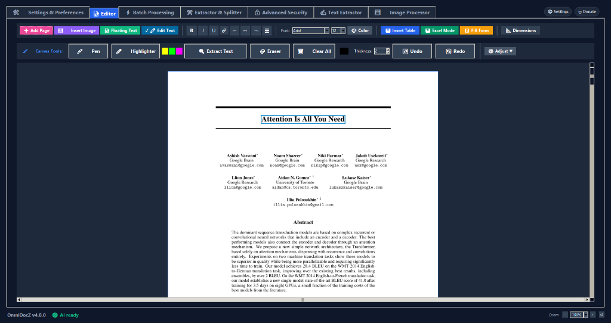
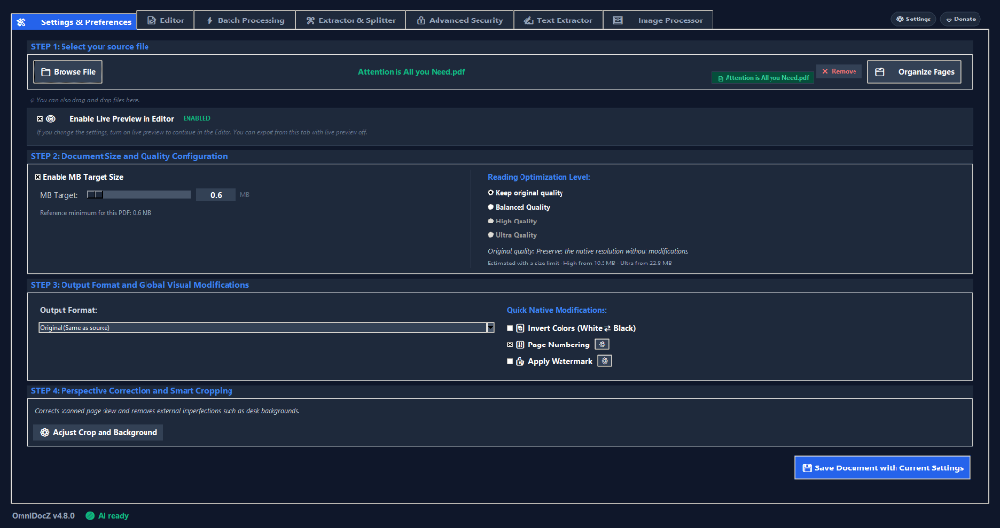

# OmniDocZ

**Edit PDFs, work with spreadsheets, clean up scans, and convert files on your PC.**

Combine Word documents, PDFs, spreadsheets, and images in one workspace. Edit native or scanned text in place, organize and extract pages visually, prepare files for sharing, and process batches offline.

  

**Windows 10 / 11 (64-bit) · Free and ad-free · Local processing · 6 languages**

[Download](#download-and-install) · [Documents & PDFs](#documents-and-pdfs) · [Spreadsheets](#excel-studio-beta) · [OCR & Scans](#ocr-and-scan-cleanup) · [Images](#image-tools) · [Security & Forms](#pdf-security-and-forms) · [Batch & Settings](#batch-processing-and-preferences)

  

## Download and install

1. Open the [latest release](https://github.com/Nightmare13123/OmniDocZ/releases/latest).
2. Under **Assets**, download **`OmniDocZ-Setup-<version>.exe`**.
3. Run the installer and open **OmniDocZ**. Drag files into any tab or click **Browse File** to begin; the interactive guide walks through the main tools on first launch.

Document processing runs locally on 64-bit Windows 10 or 11 with no account or subscription. An internet connection is used only for downloads, optional add-on bundles, and update checks. Available in **English, Spanish, French, Portuguese, German, and Italian**.

| Release asset | What it gives you |
| --- | --- |
| `OmniDocZ-Setup-<version>.exe` | The Windows desktop application. Start here for a new installation or update. |
| `ai_bundle.zip` | Optional offline AI for OCR on scanned pages and automatic background removal. Select it during setup or install and repair it from the AI status indicator in the bottom bar (or **AI component…** in the version menu). |
| `fonts_bundle_essential.zip` and `fonts_bundle_full.zip` | Optional typeface collections for document editing. Install during setup or via **Get More** in the editor’s font menu. You can also import your own fonts. |

## Documents and PDFs

### Edit and compose

- **Edit text in place:** Turn on **Edit Text** to modify native or scanned PDF text directly on the page. OmniDocZ matches the original font, size, color, and ink intensity, and applies formatting to selected words within a line.
- **Compose from scratch or build on existing files:** Add formatted text with paragraph alignment, movable text boxes, floating resizable images, clickable hyperlinks, and editable tables (with XLSX export).
- **Draw, highlight, and adjust pages:** Annotate with pen and highlighter tools, erase strokes with undo/redo, rotate pages, and change page dimensions (A4, Letter, Legal, square, or custom).
- **Ready-to-use typography:** Choose from 100+ fonts in the editor (including 25 bundled open-source families), expand with optional packs, or add your own `.ttf`/`.otf` fonts.

### Combine, organize, and extract

- **Merge mixed formats:** Load multiple PDFs, Word or OpenDocument files, spreadsheets, and images into one workspace, then export as a single document—or consolidate multiple files into a multi-sheet Excel workbook.
- **Organize files or pages:** Reorder whole source files when working with multiple documents, or rearrange, rotate, delete, and insert blank pages using thumbnail previews.
- **Visual Extractor & Splitter:** Browse thumbnails across one or more documents, open full-page previews, select pages visually or with quick presets and ranges, reorder the output sequence directly, and add page numbers before exporting.

### Preview, optimize, and export

- **Fit a target file size:** Set a maximum size in MB and pick **Original**, **Balanced**, **High**, or **Ultra** quality. OmniDocZ estimates the minimum achievable size across supported export formats—including PDF, DOCX, PNG, JPEG, and WebP—and shows which quality levels fit your limit.
- **Live Preview:** See color inversion, watermarks, and page numbering applied in real time before saving.
- **Consistent branding and pagination:** Add text or logo watermarks with adjustable opacity, and stamp page numbers in headers or footers with custom placement, format, font, starting number, and cover-page skipping.

| Task | Supported formats and options |
| --- | --- |
| Open or combine documents | PDF, Word `.docx`, Writer `.odt`, Excel `.xlsx` / `.xls`, Calc `.ods`, `.csv`, PNG, JPEG, and WebP |
| Export documents or extracted pages | PDF, archival PDF/A-1b, DOCX, ODT, XLSX, ODS, PNG, and JPEG |
| Extract tabular data | Export detected PDF tables to XLSX, ODS, or CSV (CSV available from **Extractor & Splitter** and **Text Extractor**) |

*Output options vary by tool and source content.*

| Settings & Preferences — Export & file size limits | Extractor & Splitter — Visual page selection |
| :---: | :---: |
|  |  |

## Excel Studio (Beta)

Create or edit workbooks in a full spreadsheet grid, use **Quick Cleanup** on the main tab for one-click fixes and export, or switch to **Docs Mode** to work with the print layout. Opens XLSX, XLS, ODS, and CSV; saves XLSX, ODS, PDF, or exports the active sheet to CSV.

| Area | What you can do |
| --- | --- |
| **Workbooks & navigation** | Add, rename, duplicate, reorder, and color-code sheet tabs. Insert, delete, hide, and resize rows and columns, freeze panes, zoom, jump to cells, and toggle gridlines or headings. |
| **Formulas & auditing** | Use AutoSum, a function assistant, and common formulas (`SUM`, `IF`, `COUNTIF`, `VLOOKUP`, and more). Audit precedents and dependents, and switch between automatic or manual recalculation. |
| **Formatting & validation** | Customize fonts, colors, borders, alignment, number formats, text wrapping, merged cells, conditional formatting, and cell data validation. |
| **Cleanup & import** | Run one-click **Quick Cleanup** (convert text to numbers, remove empty rows, auto-fit columns, apply table styling), plus multi-key sorting, filtering, deduplication, text-to-columns, paste special, and CSV or PDF table import. |
| **Charts & objects** | Build column, bar, line, and pie charts from selected cells, and attach cell comments, hyperlinks, and images. |
| **Print & document export** | Configure paper size, orientation, margins, and print area. Export the whole workbook or active sheet, or insert sheet data directly into an editable document table. |

## OCR and scan cleanup

- **Auto-crop and deskew scans:** Trim dark borders, center the page, and straighten tilted scans in one step (**Auto-Crop & Deskew**), adjust the four corners manually for perspective correction, or straighten content on its own.
- **Guided scan preparation:** Before running in-place OCR editing, OmniDocZ detects tilted or uncropped scans and suggests adjusting them first for cleaner text alignment.
- **Create searchable PDFs:** Overlay a selectable, searchable text layer onto scanned pages without altering their look, with language profiles (European/Spanish or English), selectable resolution (150–450 DPI), and optional image enhancement.
- **Recover text selectively or in full:** Use **Extract Text** in the editor to copy text from any region, or open PDFs, DOCX, ODT, and images in **Text Extractor** to recover, reformat, and export editable text.

*OCR on scanned pages and images requires the optional local AI component.*

## Image tools

| Tool | What you can do |
| --- | --- |
| **AI background removal** | Remove backgrounds locally in batch and save transparent PNGs. Choose between **Balanced** (ISNet), **Maximum Detail** (BEN2 FP16), and **Ultra Fast** (Silueta) modes, with background pre-warming, hardware guidance, automatic model fallback, and optional edge cleanup. |
| **Manual cleanup** | Fine-tune transparency and edges by hand with brush, eraser, selection, and crop tools with undo support. |
| **Outlines & silhouettes** | Generate coloring-page line art or trace outer silhouettes for stickers, logos, and stencils. Uses AI for photos and an instant offline engine for high-contrast graphics—saving as JPEG (white background) or transparent PNG. |
| **A4 layouts & image viewer** | Lay out images or PDF pages into printable albums or contact sheets (1, 2, 3, 4, 6, or 8 per page, or automatic layout preserving proportions), and inspect files in the built-in viewer with fit-to-window, actual size, dimensions, and file size. |

*AI background removal uses the optional local AI component; manual cleanup, classic outlines, A4 layouts, and the viewer work without it.*

  

## PDF security and forms

| Tool | What you can do |
| --- | --- |
| **Password protection & unlock** | Encrypt PDFs with AES-256, configure open passwords and permissions (printing, copying, editing), optionally apply watermarks or optimization, and detect or remove protection when you have the current password. |
| **Permanent redaction** | Mark areas visually or find all matches of a phrase, then permanently strip the underlying text and images from the saved copy. |
| **Digital & visual signatures** | Sign with a `.pfx` or `.p12` certificate (PAdES / PKCS#7), add a visible stamp or handwritten signature image, or insert a native PDF signature field for later signing. |
| **Interactive forms** | Fill PDF form fields (text boxes, checkboxes, radio buttons, dropdowns, and lists) and save either an editable copy or a flattened version. |
| **Metadata editor** | Inspect, edit, or clear PDF properties including title, author, subject, keywords, creator, and producer. |

## Batch processing and preferences

- **Process a queue in one run:** In **Batch Processing**, apply format conversion, compression, a target MB limit, page rotation, color inversion, page numbering, watermarks, or AES-256 encryption across multiple files—producing individual outputs for each file.
- **Hardware-aware performance:** Automatically detects your PC’s RAM, CPU, and GPU to set safe queue/page limits and choose CPU vs. GPU intelligently (avoiding instability on entry-level GPUs), with manual overrides in **Settings**.
- **Built for daily use:** Switch among 6 interface languages, drag and drop files onto any tab, reopen your last document, replay the interactive guide, manage app and AI bundle updates from the bottom bar, and send feedback directly from the app.

---

OmniDocZ is developed by **NightmareZDev** and is part of **NightmareZProtocol**. If the app helps with your work, you can [support its development on Ko-fi](https://ko-fi.com/nightmarezdev).
